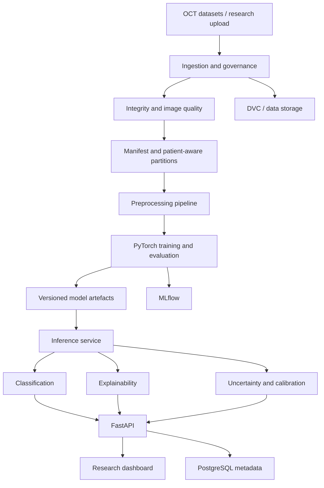

# NeuroVision System Architecture

**Status:** Logical architecture proposal; not implemented or verified.

## 1. Architectural goals
- Separate research pipelines from the user-facing application.
- Make data lineage, model identity and experiment configuration traceable.
- Keep explainability, uncertainty and calibration independently testable.
- Support reproducible offline research and controlled online inference.
- Avoid storing unnecessary patient-identifying information.

## 2. Logical components

## 3. Research plane
The research plane owns acquisition records, manifests, preprocessing, training, evaluation, explainability experiments and uncertainty/calibration experiments. Notebooks are exploratory; repeatable production research workflows belong in tested package modules and scripts.

## 4. Application plane
The application plane exposes model inference and research artefacts through FastAPI and a web dashboard. The API must identify the model version and preprocessing contract. PostgreSQL stores application metadata, not raw medical images by default. Image and artefact storage policy remains an open decision.

## 5. Cross-cutting services
- Git: source and configuration history.
- DVC: dataset/pipeline versioning, with remote storage to be selected.
- MLflow: experiment runs, parameters, metrics and artefacts.
- Pytest: unit, integration, data and scientific regression tests.
- Docker: service packaging.
- GitHub Actions: automated quality gates.
- Structured logging and monitoring: operational visibility without sensitive payloads.

## 6. Data flow
1. Register a dataset and verify its access terms.
2. Acquire data without modifying originals; record checksums.
3. Build manifests with labels and pseudonymous patient grouping where permitted.
4. Audit image integrity, metadata, duplicates and class distributions.
5. Generate patient-aware partitions and test for overlap.
6. Fit preprocessing only on training data where fitting is required.
7. Train and track models with immutable configuration references.
8. Use validation data for model selection and a designated calibration set for calibration.
9. Evaluate once on a held-out internal test set; evaluate independently sourced data for external validation.
10. Register model, preprocessing and evaluation metadata before exposing inference.

## 7. Security and privacy
Validate file type, dimensions and size; do not trust extensions. Apply least privilege and secret management. Avoid logging image contents or direct identifiers. Dataset access and retention must comply with source terms and applicable institutional/legal requirements.

## 8. Failure behaviour
Invalid images, unavailable models and failed explanation generation must produce explicit errors or unavailable states. The application must never silently substitute a different model or present missing uncertainty as zero uncertainty.

## 9. Open architecture decisions
Storage backend, frontend framework, authentication model, model-serving strategy, inference retention policy and supported input formats are not yet final.